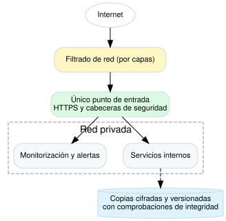

[English](README.md) · **Español**

# VPS as code: gestionar los servidores de una empresa pequeña desde un repositorio Git

Caso de estudio de [Kortem](https://kortem.es). Hecho con mis dos cofundadores. El repositorio es privado, así que esto cubre el diseño, una lección de operarlo y lo que construí yo.

## El problema

Una empresa pequeña ejecuta unos cuantos servicios internos en un VPS. Tres personas lo tocan, y «cambié algo a mano y se me olvidó» es el riesgo principal.

## El enfoque

El servidor está definido en el repositorio. Un cambio es un commit, y un script deja el servidor igual que el repositorio. El historial dice qué cambió, quién lo cambió y por qué, y el servidor se puede reconstruir desde cero.

## Principios de diseño

| Principio | Por qué |
|---|---|
| Un único punto de entrada público | Menos superficies expuestas y un solo lugar donde gestionar HTTPS. |
| Filtrado de red por capas | Defensa en profundidad: ningún ajuste se fía solo. |
| Versiones fijadas | Las actualizaciones son commits deliberados que se pueden revisar y revertir. |
| Mínimo privilegio para los contenedores | Reduce el daño cuando algo se comporta mal. |
| Acceso restringido al runtime de contenedores | La monitorización solo recibe el acceso de lectura que necesita. |
| Logs acotados y una sola ubicación de datos | Fácil de ver y fácil de respaldar. |
| Copias cifradas y versionadas con comprobaciones de integridad periódicas | Una copia solo sirve si se puede restaurar. |

## Lección: una copia que falla no debe parar las demás

Un trabajo de copias se detenía en el primer componente que fallaba, y el resto quedaba sin proteger hasta que alguien lo notaba. Lo arreglé: un componente fallido ya no detiene la ejecución, se conserva la última copia buena, las credenciales se ocultan en los logs y el trabajo termina igualmente con error para que salte la alerta.

Una copia que falla en silencio es peor que una que falla con ruido, y un componente roto nunca debería tumbar todo el trabajo.

## Lo que construí

Mis pull requests fusionados en este repo cubren: el despliegue del CRM y ERP interno, el lector de correo y las alertas matinales, y los arreglos de la lección de las copias, de una aplicación cuya descarga fallaba y paraba a las demás, y de un bloque de alertas duplicado que impedía arrancar la monitorización.

## Stack

Linux · Docker Compose · proxy inverso · shell · copias de seguridad automatizadas
