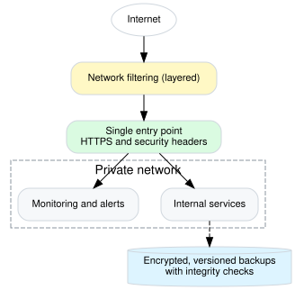

**English** · [Español](README.es.md)

# VPS as code: running a small company's servers from a Git repo

A case study from [Kortem](https://kortem.es). Built with my two co-founders. The repository is private, so this covers the design, a lesson from operating it, and what I built.

## The problem

A small company runs a handful of internal services on one VPS. Three people touch it, and "I changed something by hand and forgot" is the main risk.

## The approach

The server is defined in the repository. A change is a commit, and one script brings the server in line with the repo. The history says what changed, who changed it and why, and the server can be rebuilt from scratch.

## Design principles

| Principle | Why |
|---|---|
| One public entry point | Fewer exposed surfaces, and one place to handle HTTPS. |
| Layered network filtering | Defence in depth: no single setting is trusted alone. |
| Pinned versions | Updates are deliberate commits that can be reviewed and reverted. |
| Least privilege for containers | Reduces the blast radius when something misbehaves. |
| Tight access to the container runtime | Monitoring only gets the read access it needs. |
| Bounded logs and one data location | Easy to see, easy to back up. |
| Encrypted, versioned backups with regular integrity checks | A backup is only useful if it can be restored. |

## Lesson: a failed backup must not stop the others

A backup job once stopped at the first failing component, so everything else went unprotected until someone noticed. I fixed it: a failed component no longer halts the run, the previous good copy is kept, credentials are masked in logs, and the job still ends with an error so the alert fires.

A backup that fails quietly is worse than one that fails loudly, and one bad component should never take the whole job down.

## What I built

My merged pull requests in this repo cover: deploying the internal CRM and ERP, the mail reader and morning alerts, and fixes for the backup lesson above, for one app failing to download stopping the others, and for a duplicated alert block that prevented monitoring from starting.

## Stack

Linux · Docker Compose · reverse proxy · shell · automated backups
